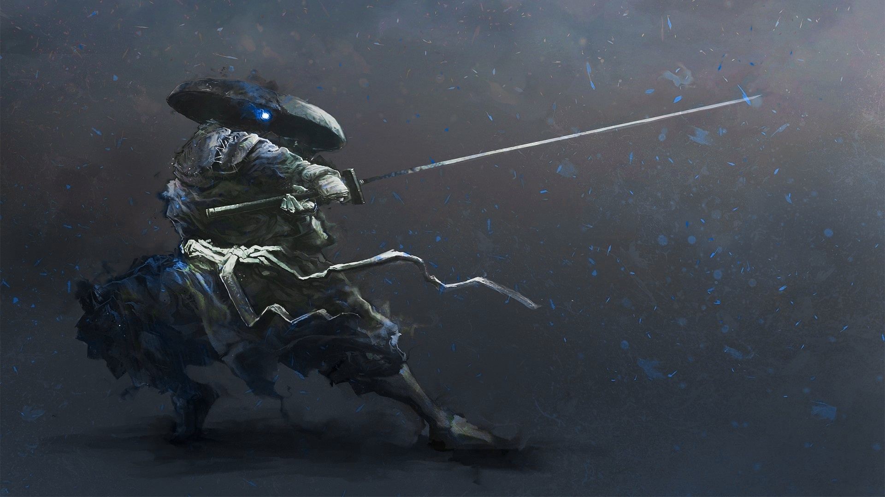

<div align="center">


<a href="https://github.com/kayo-willian">
  
</a>

<br/>



<br/><br/>


</div>

---

<table>
<tr>
<td width="58%" valign="top">

### `$ whoami`

I document my path into **Linux**, **networking** and **defensive security**.
Every project here starts with a real problem and ends with what I learned solving it.

```bash
name      : Kayo
base      : Brazil
focus     : Blue Team / Defensive Security
stack     : Linux, Networking, Virtualization
studying  : OSINT, Threat Investigation
method    : build, break, troubleshoot, document
```

</td>
<td width="42%" align="center" valign="middle">


</td>
</tr>
</table>

---

<div align="center">

## ⚔️ Technical Arsenal

**Linux**


**Networking**


**Containers**


<br/>

**Infrastructure & Monitoring**


**Virtualization**


**Tools**


**Security focus**


</div>

---

<div align="center">

## 🗡️ Projects

</div>

### 🌐 Featured Project

<table>
<tr>
<td width="100%" valign="top">

<h3>Enterprise NOC — From Scratch</h3>

<p>
  
  
</p>

<p>
  <code>Cisco</code> ·
  <code>Linux</code> ·
  <code>Docker</code> ·
  <code>Zabbix</code> ·
  <code>Grafana</code> ·
  <code>NOC</code>
</p>

<p>
  An end-to-end enterprise IT infrastructure project,
  built around a physical networking laboratory and
  centralized Network Operations Center.
</p>

<p>
  The project covers structured cabling, network racks,
  Cisco routing and switching, VLAN segmentation,
  Linux servers, containerized services, infrastructure
  monitoring, and technical troubleshooting.
</p>

<p>
  Documentation also includes infrastructure architecture,
  implementation evidence, and a financial analysis
  comparing deployment and operational costs.
</p>

<p>
  <a href="https://github.com/kayo-willian/enterprise-noc-from-scratch">
    
  </a>
</p>

</td>
</tr>
</table>

### 🛠️ Tools & Utilities

<table>
<tr>
<td valign="top">

#### Scroll Lock RGB Fix
`Python` · `Linux` · `GNOME/Wayland`

Fixes RGB lighting on generic gaming keyboards that use the Scroll Lock LED as a firmware trigger, on systems where the compositor doesn't sync the LED state with the hardware.

[](https://github.com/kayo-willian/scrolllock-rgb-fix)

</td>
</tr>
</table>

### 📡 Networking & Systems Labs

<table>
<tr>
<td width="50%" valign="top">

#### Packet Tracer Labs
`Cisco` · `VLAN` · `DHCP` · `DNS` · `OSPF`

Networking labs that grow from core fundamentals to multi-site infrastructure, routing, OSPF and troubleshooting.

[](https://github.com/kayo-willian/packet-tracer-labs)

</td>
<td width="50%" valign="top">

#### Linux Networking Labs
`Terminal` · `Networking` · `Troubleshooting`

Practice with Linux and the command line: commands, networking and system administration.

[](https://github.com/kayo-willian/linux-networking-labs)

</td>
</tr>
<tr>
<td width="50%" valign="top">

#### Ubuntu Server Labs
`Ubuntu` · `Services` · `Security`

Hands-on Linux administration: networking, services, security and multi-server infrastructure, built as a personal reference guide.

[](https://github.com/kayo-willian/ubuntu-server-labs)

</td>
<td width="50%" valign="top">

#### Debian Server Labs
`Debian` · `Administration` · `Infrastructure`

Debian server labs focused on administration, networking, services, security and infrastructure.

[](https://github.com/kayo-willian/debian-server-labs)

</td>
</tr>
</table>

### 🎮 Game Development

<table>
<tr>
<td valign="top">

#### Channel Blue
`GDevelop 5` · `2D Game`

My first 2D game, an introduction to game development and interactive projects.

[](https://github.com/kayo-willian/channel-blue)

</td>
</tr>
</table>

---

<div align="center">

## 📬 Contact

[](https://www.linkedin.com/in/kayo-willian)
[](mailto:kayowillian.net@protonmail.com)


</div>
